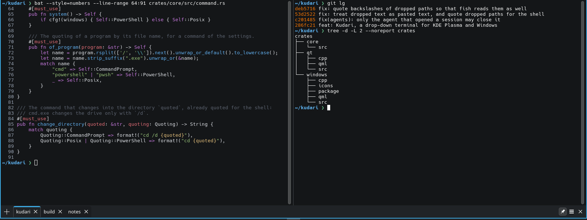
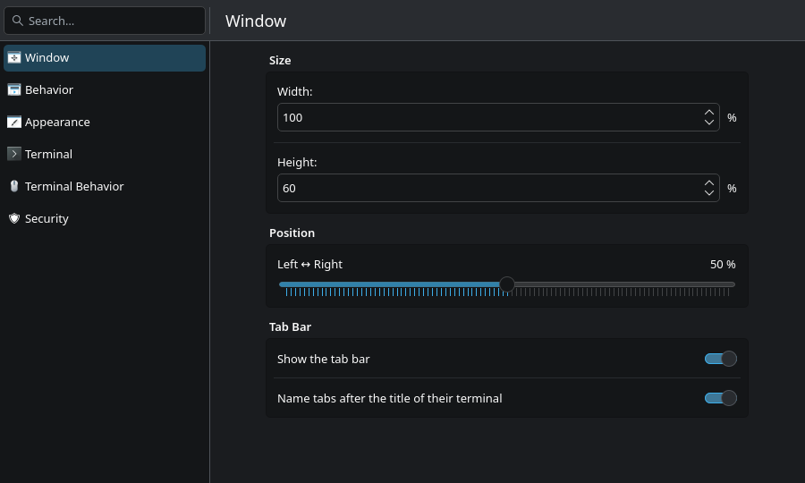
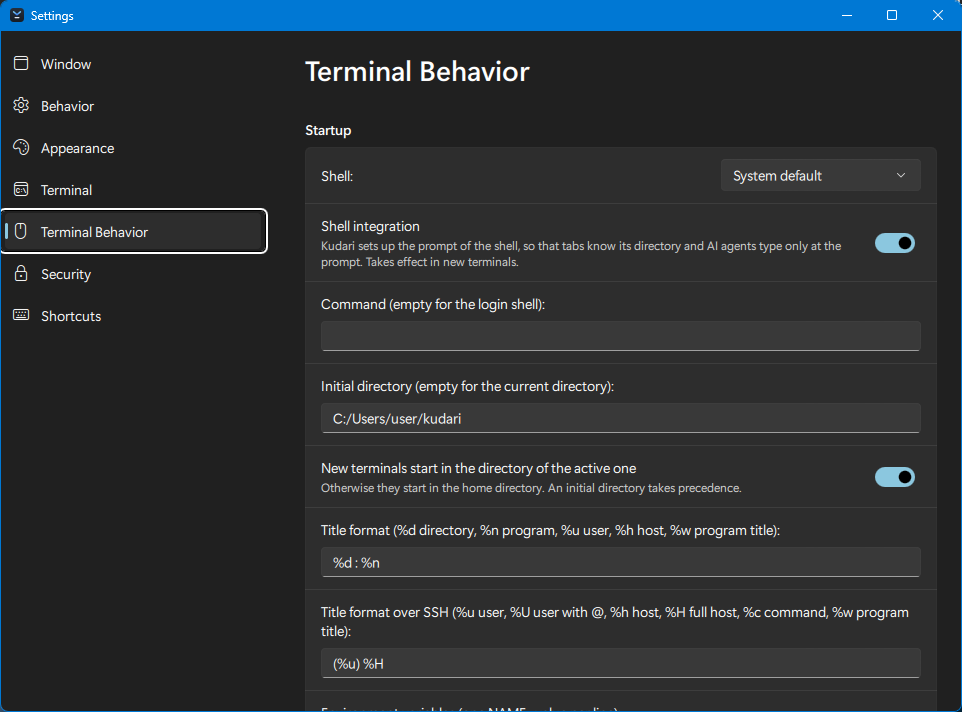
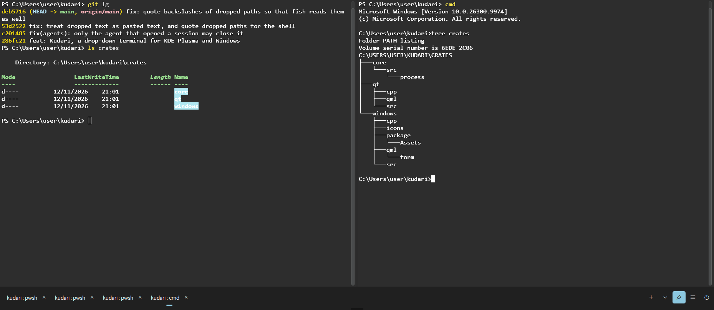

# Kudari

A drop-down terminal for KDE Plasma on Wayland and for Windows. A key, F12 by default on KDE
and Ctrl+F12 on Windows, slides a terminal down from the top of the screen, over whatever
window is open; the same key sends it away again, and the shells in it keep running. Kudari
keeps the workflow of [Yakuake](https://apps.kde.org/yakuake) and is built anew in Rust and
QML, with Kirigami on KDE and the look of Windows 11 there.

The name is the Japanese 下り, *kudari*, "downwards", as the terminal comes down from the top
of the screen.



## What it does

- **Always one key away.** The window appears on a global shortcut, on the screen of your
  choice, with the width, height and position you set; a grip below it changes the height.
- **Sessions and splits.** Tabs in a single bar hold the sessions, and each session can be
  divided into several terminals, side by side or stacked.
- **Looks like your desktop.** Colors, fonts and icons come from the Plasma theme and
  follow it when it changes, so there are no color schemes to maintain.
- **A full terminal.** Search, a selection mode, markers in the scrollback, links to URLs
  and to files (which open in your editor at the right line), a badge, Konsole's
  `.keytab` key bindings.
- **Keeps an eye on things.** Notifications when a terminal shows activity, falls silent
  or its program ends, and locks against closing a session or typing into it by mistake.
- **Works with AI agents.** Through `kudari mcp`, an agent such as Claude Code reads the
  terminals and, if you allow it, types commands that you confirm with Return. Kudari asks
  you before each new agent gets access.
- **At home for Yakuake users.** The first start offers to take over the settings of
  Yakuake and the profile of Konsole, and the D-Bus interface has the methods of Yakuake,
  so scripts carry over.
- In English and German, with a man page.

## Screenshots

| | |
|---|---|
|  |  |
| The settings on KDE Plasma | The same settings on Windows 11 |



## Why

Yakuake has been the drop-down terminal of KDE for many years. Kudari started as a rebuild
of it and aims to be a modern and safe successor that feels the same:

- **Made for Plasma on Wayland.** The window is a layer-shell surface, which the compositor
  places at the top of the screen, and the interface is written in QML and Kirigami, the way
  KDE builds applications today.
- **Memory-safe where it matters.** What comes from outside is handled in Rust: the output
  of programs with its control sequences, pasted text, D-Bus calls, and the files of Yakuake
  and Konsole that the import reads.
- **Safe by default.** Running commands over D-Bus is off until switched on, and so are
  AI agents; once switched on, each new agent still needs your OK, and its commands wait for
  your Return. Pasted text
  cannot inject control sequences, programs may write to the clipboard but not read it, links
  open only for `http`, `https` and `mailto` unless you allow more, and file links never start
  programs.
  [docs/usage.md](docs/usage.md#security) has the details.
- **Releases you can check.** Each release is built twice to show that it is reproducible,
  and is published with signatures, checksums, SBOMs and build provenance.

## How it works

```
┌──────────────────────────── Kudari ────────────────────────────┐
│  qml/         window, tab bar, settings    QML and Kirigami     │
│  crates/qt/   terminal item, controller    Rust, cxx-qt         │
│  crates/core/ terminals, sessions, input,  Rust,                │
│               settings, AI agents          alacritty_terminal   │
│  src/         D-Bus, settings file,        Rust, zbus           │
│               import from Yakuake                               │
│  cpp/         shortcut, notifications,     C++ on KDE           │
│               links, tray, translations    Frameworks           │
└─────────────────────────────────────────────────────────────────┘
```

The terminal emulation is `alacritty_terminal`, the core of the Alacritty terminal. Kudari
runs each shell on its own pseudo-terminal, feeds its output to the emulator, and draws the
result in a QML item of its own, written in Rust. What does not depend on Qt or KDE, from
the input to the sessions, is in `crates/core`, and the Qt parts that another front end can
share are in `crates/qt`. cxx-qt connects the Rust code to Qt and QML. KDE Frameworks have no Rust bindings, so the ones Kudari uses, such as KGlobalAccel for
the global shortcut, KNotification and KIO, are reached through a thin C++ layer in `cpp/`.
Layer Shell Qt places the window. Settings are stored in `~/.config/kudarirc`.

## Install

### From a release

The [releases](https://github.com/MarcJose/kudari/releases) contain the source code with all
Rust crates, and a package for x86_64 built on Arch Linux. Check the download first, as
[docs/releases.md](docs/releases.md#checking-a-download) describes. On Arch Linux, the package
unpacks into the system:

```sh
sudo tar -x -C / -f kudari-1.2.0-x86_64-linux.tar.xz
```

On other distributions, build the source of the release as described next.

On Windows 11, the release has an MSIX package and a ZIP archive, both signed
with a certificate of Kudari's own rather than one of a certification authority. To install
the MSIX package, trust its certificate once, in an administrator PowerShell, then install:

```powershell
Import-Certificate -FilePath kudari-1.2.0-x86_64-windows.cer -CertStoreLocation Cert:\LocalMachine\TrustedPeople
Add-AppxPackage kudari-1.2.0-x86_64-windows.msix
```

The package adds Kudari to the Start menu and the command `kudari`, for `kudari mcp`. The
ZIP archive needs no installation: unpack it and start `kudari.exe`.

### From source

Kudari needs Rust 1.95 or newer, CMake, Qt 6 and KDE Frameworks 6 with Layer Shell Qt. On
Arch Linux, these are

```sh
sudo pacman -S --needed rust cmake lld $(grep -v '^#' .github/arch-packages.txt)
```

and other distributions name the packages similarly. Then build and install, here into
`~/.local`:

```sh
cmake -B build -DCMAKE_INSTALL_PREFIX=~/.local
cmake --build build
cmake --install build
```

With KDocTools installed, this also builds the man page. Use `/usr` as the prefix to install
for all users. With `lld` installed, the build links with it; otherwise it falls back to
`ld.gold` and warns.

### The first start

Kudari starts hidden, best together with Plasma under System Settings → Autostart. Press
F12 to bring it down. The first start asks which shortcut to use and whether to take over the
settings of Yakuake and Konsole; their files are only read. Everything else is in the
settings, behind the menu button in the bar at the bottom, and `man kudari` describes the command
line, the D-Bus interface and the files.

## Documentation

- [docs/usage.md](docs/usage.md): settings, coming from Yakuake, AI agents, D-Bus and security
  settings
- [CHANGELOG.md](CHANGELOG.md): what changed in each release
- [CONTRIBUTING.md](CONTRIBUTING.md): building, testing and submitting changes
- [CODE_OF_CONDUCT.md](CODE_OF_CONDUCT.md): how we treat each other
- [SECURITY.md](SECURITY.md): reporting vulnerabilities privately
- [docs/releases.md](docs/releases.md): how releases are made, checked and rebuilt

## License

MIT, see [LICENSE](LICENSE). The copyright of each file is in its header or in
`REUSE.toml`. `tests/gui/fake-input.xml` is KWin's protocol and stays under
LGPL-2.1-or-later. The Rust crates in the binary, among them `alacritty_terminal` under
Apache-2.0, are listed with their licenses in `THIRD_PARTY_LICENSES`. Qt and KDE Frameworks
are linked dynamically and keep their own licenses.

Until 2026-11-07 Kudari was under GPL-3.0-only, because it contained parts of Yakuake and
Konsole; versions up to then stay under that license.

Kudari grew out of Yakuake and takes ideas from Konsole, and it needs neither of them. It
contains no code, texts, translations or graphics of theirs any more: those parts were
rewritten or replaced in 2026, as the history of the repository records. A few short
labels, such as "Help" or "Enlarge Font", read the same, and the settings and the D-Bus
interface stay compatible with Yakuake. Both projects are thanked in
`AUTHORS` and the About dialog.
